# What changed in the room

Film a room, rearrange it, film it again. This tool turns the two phone videos into one 3D room, boxes everything that moved, appeared or disappeared, and says what happened in a plain sentence.

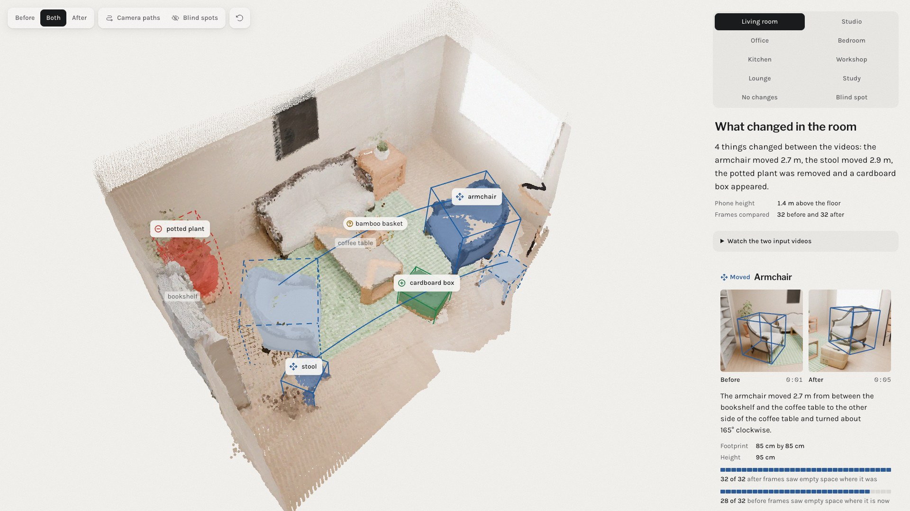

All ten example rooms are already computed, so one command opens them in the viewer. Running it on your own two videos takes one more command and one number, the height you held the phone at ([Run it](#run-it)).

```bash
cd viewer && npm install && npm run dev
```

## Benchmarks

| | First run on held-out rooms | Current detector, all rooms |
|---|---|---|
| Changes found | 23 of 33, plus 3 partly | 33 of 44, plus 1 partly |
| False alarms | 4 of 30 reports | 1 of 35 reports |
| Precision, recall, F1 (per object) | 77%, 70%, 0.73 | 94%, 75%, 0.84 |
| Camera path error | 1.5 to 2.9 cm | 1.8 to 3.5 cm |
| Box centre error on the floor | | 5 to 12 cm |
| Box bottom error | | Under 1.6 cm in 7 of 8 rooms |
| Distance moved, error | | 1 to 7 cm in 7 of 8 rooms |
| Names exactly right, right kind of thing | | 18 of 33, 26 of 33 |
| Cited furniture that really stands there | | 45 of 46 pieces; the one ghost is never cited |
| Time per pair | | 90 to 240 s, median 105 s, Apple M5 Pro laptop |

The held-out column is the honest number. Each of those six rooms was rendered after the detector was frozen and scored exactly once, and that first score is saved unedited in [`results/held-out`](results/held-out).


### Against a contemporary parallel

The closest recent work is [3DGS-CD](https://arxiv.org/abs/2411.03706) (Lu, Ye and Leonard, MIT, 2024). It also detects moved, removed and added objects from two sets of ordinary photos.

| | This repo | [3DGS-CD](https://github.com/520xyxyzq/3DGS-CD) | [MV-3DCD](https://chumsy0725.github.io/MV-3DCD/), CVPR 2025 |
|---|---|---|---|
| Before input | One 15 to 30 s phone video | 150 to 200 photos | Enough photos to train a 3D Gaussian splat |
| After input | One phone video | As few as 1 photo; 4 in its benchmark | As few as 5 photos |
| Camera poses | Predicted along with the 3D model | COLMAP structure from motion | COLMAP structure from motion |
| Per-room training | None | A 3D Gaussian splat of the before room | A 3D Gaussian splat plus fine-tuning |
| Says which kind of change | Moved, added or removed | Moved, added or removed | No, one "changed" mask |
| Output | 3D boxes and sentences | 3D segments and each move's pose | 2D masks |
| Reported accuracy | Per-object F1 0.73 on first runs | Per-voxel F1 96.4 to 98.8% | Per-pixel F1 0.612 on [PASLCD](https://huggingface.co/datasets/ChamudithaJay/PASLCD) |
| Time | 90 to 240 s end to end | 18 to 58 s, plus splat training | Not reported |

These numbers are not a head-to-head result. 3DGS-CD scores how many voxels of each object it gets right on its own five scenes, while this repo scores whether each object was found at all in a whole room, and nobody has run both on the same footage. What the table does show is a difference in the job. 3DGS-CD gets near-perfect masks from a dense before capture and a trained model, while this repo takes two quick walks, trains nothing, and says what happened in words. The one earlier work we found that also writes sentences is [Qiu et al., WACV 2023](https://mlanthology.org/wacv/2023/qiu2023wacv-3d/), and it needs two 3D point clouds as input.

## 1. Where it came from

[Standard Physics](https://standardphysics.app) ([repo](https://github.com/Imhaohao/standardphysics)) turns an iPhone LiDAR walk into a measured room model, checks it against accessibility rules, and proposes furniture moves.

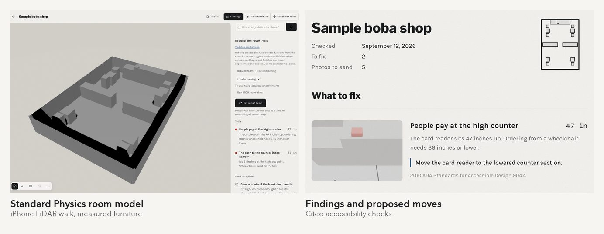

Its loop had one unchecked step. The software re-checks a proposed move, but nothing confirmed that the owner actually made it.

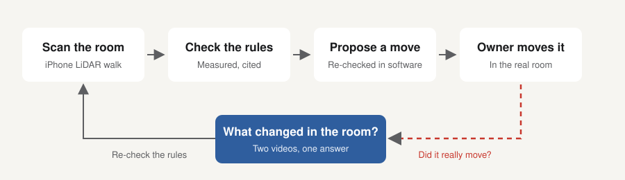

The capture cutter [`capture_pair.py`](scripts/capture_pair.py) reads the camera track that the Standard Physics iPhone app records with [ARKit](https://developer.apple.com/documentation/arkit), and the held-out real pair below comes from two Standard Physics library captures.

## 2. The problem

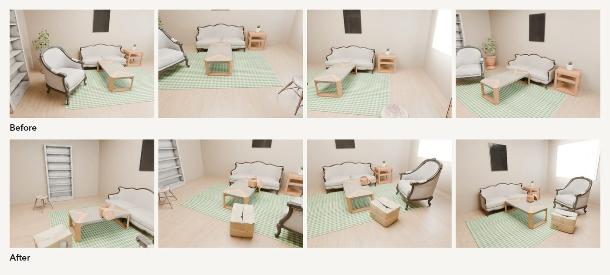

The two walks take different paths and come with no camera poses. A spot that one video never saw has to stay unknown rather than become a change, so the tool must tell "gone" apart from "not looked at".

## 3. How we solved it

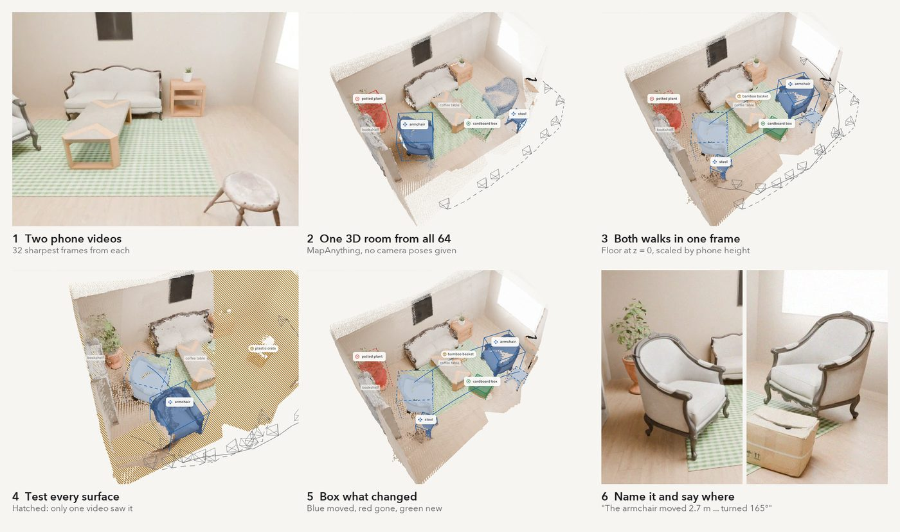

The key step tests sightlines instead of differencing two models. Every before point is projected into every after frame.

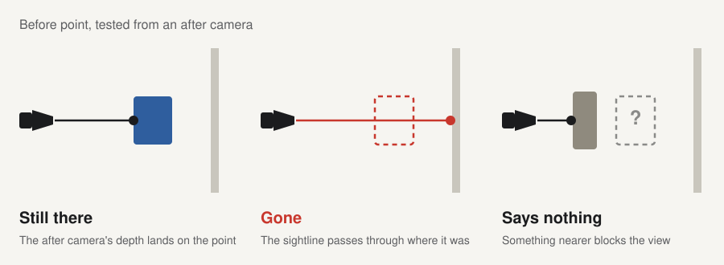

A region counts only if 85% of the sightlines into it saw empty space, and it has to stand on the floor or a table.

| Step | Model or rule | Code |
|---|---|---|
| Pick 32 sharp frames per video | Sharpness per stretch | [`video.py`](standardphysics_changes/video.py) |
| One 3D room from all 64 frames | [MapAnything](https://github.com/facebookresearch/map-anything) | [`reconstruct.py`](standardphysics_changes/reconstruct.py) |
| Floor at z = 0, metres from phone height | Floor plane fit, median camera height | [`geometry.py`](standardphysics_changes/geometry.py), [`pipeline.py`](standardphysics_changes/pipeline.py) |
| Still there, gone or no evidence | The sightline test above | [`evidence.py`](standardphysics_changes/evidence.py) |
| Regions, boxes, support | 85% empty sightlines, 75% support | [`regions.py`](standardphysics_changes/regions.py) |
| Names | [Qwen3-VL](https://github.com/QwenLM/Qwen3-VL) on [MLX](https://github.com/ml-explore/mlx) | [`naming.py`](standardphysics_changes/naming.py) |
| A gone region plus a new one becomes a move | [DINOv2](https://github.com/facebookresearch/dinov2) fingerprints, size, name | [`matching.py`](standardphysics_changes/matching.py) |
| Furniture to describe against | [Mask2Former](https://bowenc0221.github.io/mask2former) | [`landmarks.py`](standardphysics_changes/landmarks.py) |
| Sentences from box geometry | Nearest named furniture | [`changes.py`](standardphysics_changes/changes.py), [`language.py`](standardphysics_changes/language.py) |

[`pipeline.py:run`](standardphysics_changes/pipeline.py) calls them in order.

### One change, from pixels to words

Every word that places a change comes from the same 3D boxes the viewer draws. The plan below is drawn straight from the living room's `scene.json`, with no hand placement.


The terminal prints the same sentences:

```text
4 things changed between the videos: the armchair moved 2.7 m, the stool moved 2.9 m, the potted plant was removed and a cardboard box appeared.
  c1  moved    The armchair moved 2.7 m from between the bookshelf and the coffee table to the other side of the coffee table and turned about 165° clockwise. (about 85 cm by 85 cm and 95 cm tall)
  c2  moved    The stool moved 2.9 m from near the coffee table to beside the bookshelf. (about 40 cm by 40 cm and 45 cm tall)
  c3  removed  The pink terracotta pot with green leaves beside the bookshelf is gone. (about 55 cm by 50 cm and 1.2 m tall)
  c4  added    A brown cardboard box appeared beside the coffee table. (about 55 cm by 45 cm and 35 cm tall)
```

And `scene.json` keeps the evidence behind each sentence (trimmed):

```json
{
  "id": "c1", "type": "moved", "name": "armchair",
  "size_text": "about 85 cm by 85 cm and 95 cm tall",
  "evidence": {
    "old_spot": { "empty_in": 32, "of": 32, "video": "after" },
    "new_spot": { "empty_in": 28, "of": 32, "video": "before" }
  },
  "before": { "box": { "center": [0.628, 2.202, 0.484], "yaw_deg": 55.8 }, "where": "between the bookshelf and the coffee table" },
  "after":  { "box": { "center": [3.3, 1.844, 0.485],  "yaw_deg": 75.3 } }
}
```

The truth was 2.67 m and a 160° turn. The scorer also checks that every piece of furniture a sentence can cite stands where a real unchanged object stands, so a sentence can't place a change beside a ghost.

## 4. What it found

Every change the current detector reports across the eight rendered rooms, framed blue for moved, red for removed and green for added:

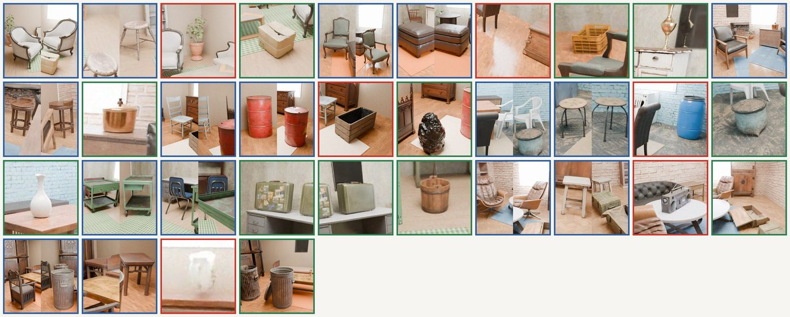

| | |
|---|---|
| 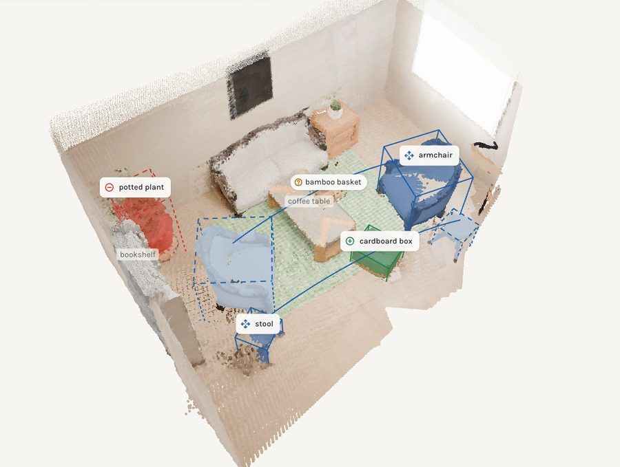 Living room, 4 of 5 | 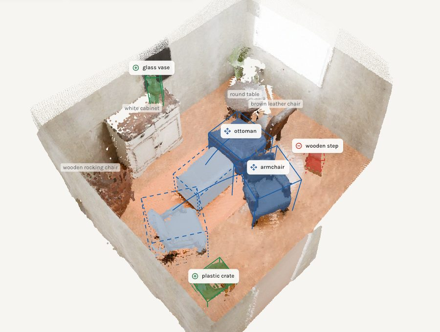 Studio, 4 of 5 |
| 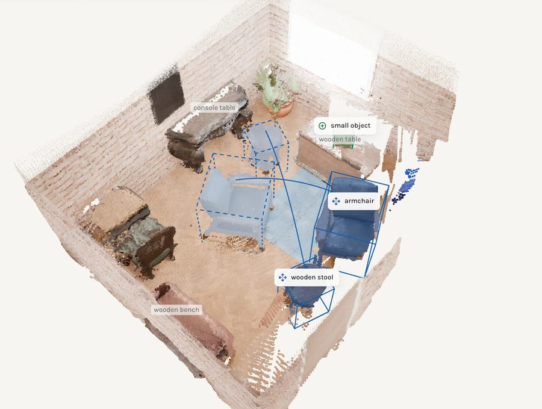 Office, 3 of 4 | 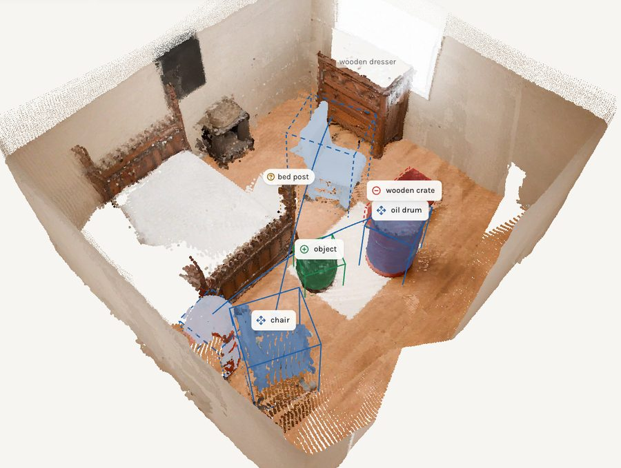 Bedroom, 4 of 5 |
| 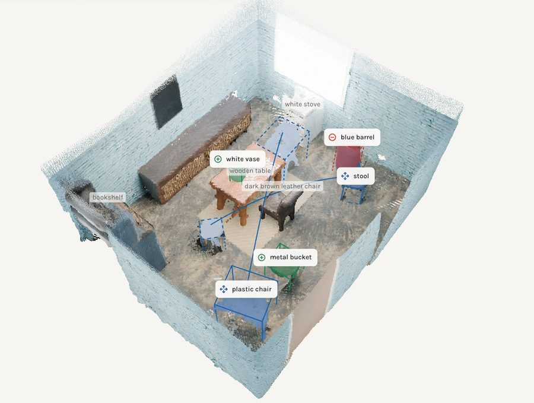 Kitchen, 5 of 5 | 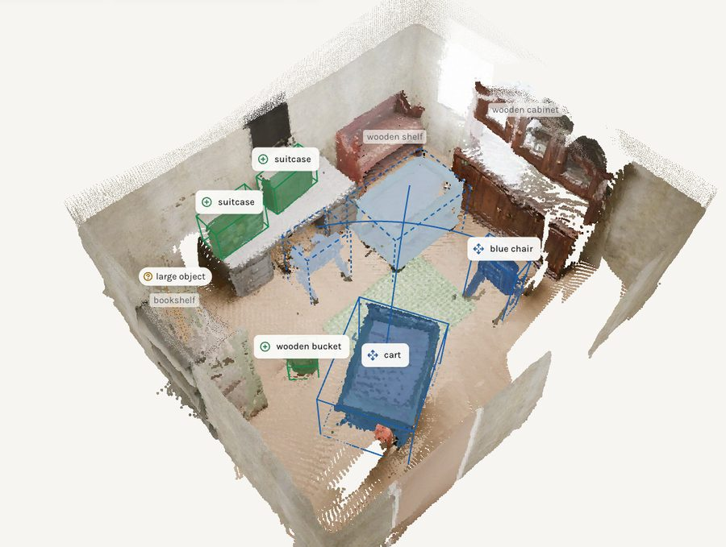 Workshop, 5 of 6 |
| 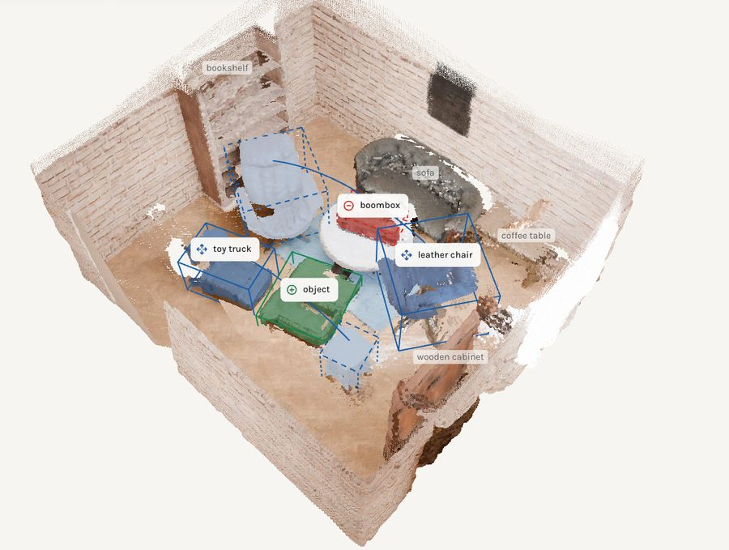 Lounge, 4 of 6 | 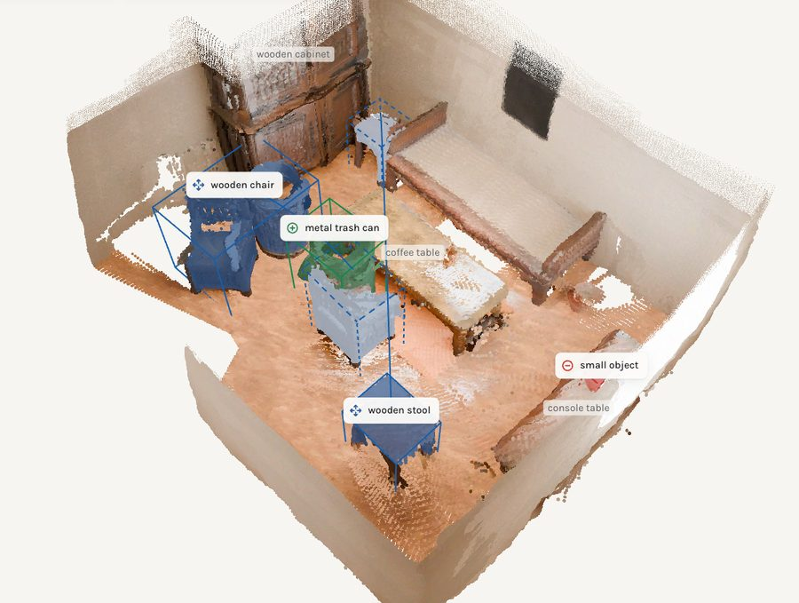 Study, 3 of 7 plus 1 partly |
| 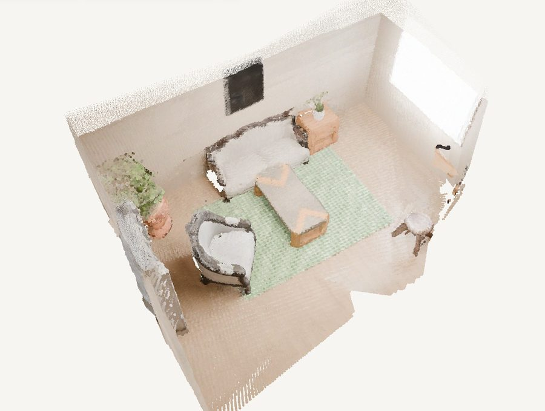 No changes, nothing reported | 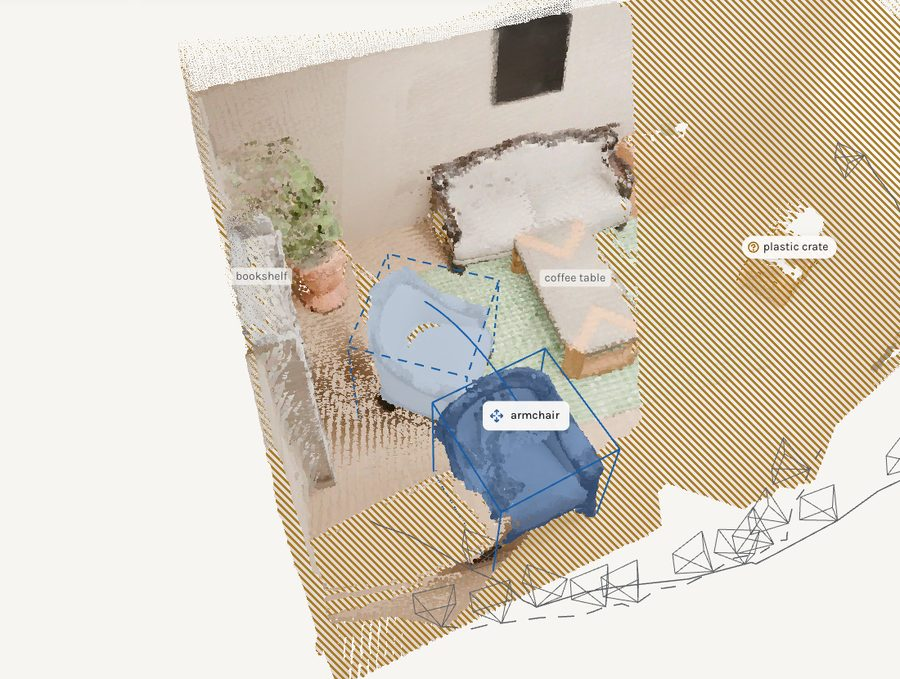 Blind spot, crate not claimed |

The rooms are rendered in [Blender](https://www.blender.org) from CC0 [Poly Haven](https://polyhaven.com) models by [`render_example_room.py`](scripts/render_example_room.py), with phone-like shake, rolling shutter, motion blur, grain and compression. Inputs and answer keys are in [`examples/`](examples).

## 5. Why it is built this way

| Choice | Instead of | Because | What it costs |
|---|---|---|---|
| One 3D model from both videos at once | Two models aligned afterwards | The furniture that stayed ties the walks together, so there is no alignment step to fail | Two walks of a large space can still drift apart, as the library pair did |
| Testing sightlines | Subtracting two point clouds | A new viewpoint or a hidden corner never turns into a change, and blind spots are shown instead of guessed | A change the other video never pointed at goes unreported |
| Pretrained models, nothing trained | Training a change detector | Any room works in about two minutes with no labelled data | It inherits their mistakes, mostly in names |
| Sentences built from boxes | Asking the vision model to describe the room | A sentence can't put an object somewhere the 3D model doesn't | The wording stays plain |
| "An object" when the two views disagree | Trusting one view's name | A vague name misleads less than a confident wrong one | 15 of 33 names are not exact |
| Phone height for scale | A marker or a tape measure in the room | Everyone knows roughly how high they hold a phone | A few percent of scale error is left |
| A 10 cm minimum size | Keeping every region | Each false alarm it removed in the living room was a sliver along a silhouette | A broom or a picture frame is missed |
| Local models on Apple silicon | A cloud vision API | Free, and no footage leaves the machine | Names need a Mac; `--namer none` runs anywhere |

## 6. Problems we hit

| Problem | Fix | Cost |
|---|---|---|
| The 3D model came out 4 to 40% too large | Rescale by the phone's height above the floor | You have to give the height |
| Open-frame bar stools on a real counter read as half empty and were reported removed | A region needs 85% of its sightlines to see empty space | A jerry can at about 50% is missed |
| A bed post appeared in mid-air, and a monitor showed up through a glass case | A raised box needs seen surface under 75% of it | The basket on the coffee table, at 54%, is set aside |
| Confident wrong names | Say "an object" when the two views disagree | No help when both views agree on the wrong name |
| One chair split into two regions | Join a same-kind piece touching either end of a move | |
| Every rule was tuned on rooms it could see | Freeze, render a new room, score once, keep that score | Six rooms used up as tests |
| Checked-in results came from videos no longer in the repo | Regenerate all ten from the committed videos and pin the numbers in tests | 36 found became 33 |
| A real library pair drifted 67 cm and gave 2 false alarms out of 3 reports | Not fixed yet | See the future list |

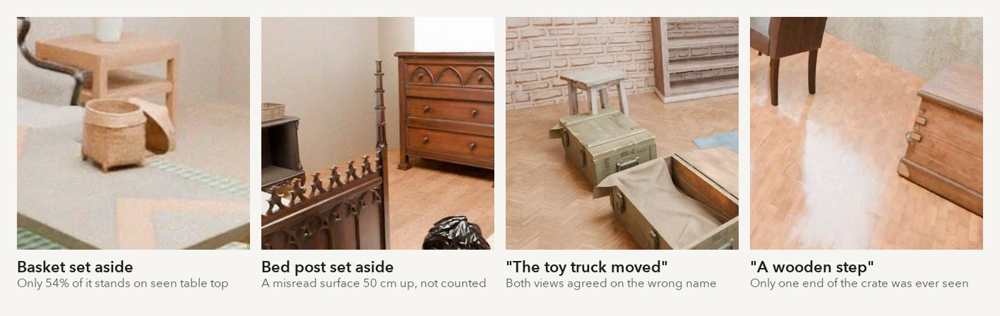

### Real phone footage

The photos show shop staff and library students, so only scores are published, in [`results/real-footage`](results/real-footage).

| Pair | Role | Camera path error | Scale error | Reported |
|---|---|---|---|---|
| Shop counter | Tuning: led to the 85% rule | 8.9 cm | 3.6% (17% with no height) | Nothing |
| Shop floor | Development | 13.3 cm | 2.6% | Nothing; one box not counted |
| Library, two captures 15 to 25 min apart | Held out, run once | 67 cm | 2.7% | 3 additions: 1 real, 2 false |

<details>
<summary>Box accuracy and every known miss</summary>

| Measure | Office | Bedroom | Kitchen | Workshop | Lounge | Study | Living room | Studio |
|---|---|---|---|---|---|---|---|---|
| Box centre error on the floor | 5.3 cm | 8.0 cm | 5.3 cm | 9.6 cm | 11.2 cm | 12.2 cm | 11.9 cm | 9.7 cm |
| Box bottom error | 1.3 cm | 0.8 cm | 1.4 cm | 1.3 cm | 13.9 cm | 1.6 cm | 1.0 cm | 1.5 cm |
| Box height error | 1.9 cm | 1.5 cm | 1.5 cm | 6.9 cm | 18.4 cm | 3.9 cm | 6.3 cm | 2.8 cm |
| 3D overlap with the true box | 0.68 | 0.65 | 0.60 | 0.53 | 0.51 | 0.63 | 0.55 | 0.57 |
| Distance moved, error | 1.2 cm | 5.6 cm | 3.4 cm | 7.4 cm | 25 cm | 3.7 cm | 4.5 cm | 3.3 cm |
| Camera path error | 2.8 cm | 2.0 cm | 1.8 cm | 3.3 cm | 3.3 cm | 2.7 cm | 3.5 cm | 3.0 cm |

Four of the five stated turns are within 10° of the truth. The studio ottoman's is 125° off.

- Living room: the basket on the coffee table is set aside by the support rule (54% < 75%).
- Office: the plastic container was never in view of the before video, so it is scored unobservable; the half-seen crate is missed.
- Studio: only one end of the crate was seen, so its box is too small to match and counts as a false alarm.
- Bedroom: three of four names are wrong (oil drum, wooden crate, object); the basket on the nightstand is missed.
- Kitchen: a "white chair" in the furniture list is part of the stove, but no sentence cites it.
- Workshop: the jerry can is missed at about 50% empty sightlines.
- Lounge: the stool is "the toy truck"; one of two crates and the brass vase are missed.
- Study: the chair's new box grows into a trash can; the pot's spot was never looked at; the vase is 8.2 cm across, under the 10 cm minimum.

[`tests/test_change_examples.py`](tests/test_change_examples.py) pins all of these as numbers, so a fix or a regression shows up as a failing test.

</details>

## 7. Future

- Film a real pair with staged changes and tape-measured truth. Only the rendered rooms have exact answers today.
- Check that the two walks line up before trusting the comparison; that drift caused the library pair's false alarms.
- Accept one measured length in the room as a second scale hint.
- Catch glass, mirrors and screens, whose depth lands behind them.
- Name objects off Apple silicon. Today `--namer none` still finds and measures everything but calls each thing "object".
- Wire it into the Standard Physics loop, so a proposed move counts as done only when a second walk shows it.
- Score on [3RScan](https://waldjohannau.github.io/RIO/) or [PASLCD](https://huggingface.co/datasets/ChamudithaJay/PASLCD) for a true head-to-head with the papers above.

## Run it

Look at the ten computed examples (Node 20.9 or newer), then open http://localhost:3000. `?room=study` opens one room directly.

```bash
cd viewer && npm install && npm run dev
```

Run your own pair. This needs macOS on Apple silicon, [uv](https://docs.astral.sh/uv/) and [ffmpeg](https://ffmpeg.org), and the first run downloads about 15 GB of weights.

```bash
scripts/setup.sh
```

```bash
.venv/bin/room-changes run before.mov after.mov --camera-height 1.4 --out viewer/public/changes/my-room
```

Reproduce an example and score it against its answer key:

```bash
.venv/bin/room-changes run examples/living-room/before.mp4 examples/living-room/after.mp4 --camera-height 1.4 --out viewer/public/changes/living-room
```

```bash
.venv/bin/room-changes evaluate viewer/public/changes/living-room examples/living-room/truth.json
```

| Option | What it does |
|---|---|
| `--camera-height 1.4` | Phone height in metres; fixes the 4 to 40% scale error |
| `--fov 69` | Horizontal field of view, if known |
| `--rotate 90` | Rotate frames of a video that records no up direction |
| `--frames 32` | Frames taken from each video |
| `--namer none` | Skip the vision model |
| `--fresh` | Ignore the cached reconstruction in `~/.cache/sp-changes` |

Walk slowly at chest height for 15 to 30 seconds with the floor in frame, and take a different path the second time over the same area. Changes under about 10 cm across are dropped.

Each run writes `scene.json` (changes, boxes, sentences, furniture, coverage, cameras), `cloud.bin` (both videos' points), `pictures/` (crops), and `evaluation.json` when scored. Every example in [`examples/`](examples) has its input videos and answer key, and its output sits in [`viewer/public/changes/`](viewer/public/changes).

All 126 Python tests and 9 viewer tests pass. The Python tests need only numpy, scipy and Pillow, and they re-score every checked-in example.

```bash
.venv/bin/python -m pytest tests
```

```bash
cd viewer && npm test
```

| Path | Contents |
|---|---|
| [`standardphysics_changes/`](standardphysics_changes) | The detector and the scorer |
| [`tests/`](tests) | Unit tests and the re-scoring of every example |
| [`viewer/`](viewer) | Next.js viewer; `public/changes/` holds each example's output |
| [`examples/`](examples) | Before and after videos and `truth.json` answer keys |
| [`results/`](results) | Held-out first runs and real-footage scores |
| [`scripts/`](scripts) | Setup, the Blender renderer and the capture cutter |
| [`docs/`](docs) | The images in this README |

## References

Models and tools
- MapAnything: [paper](https://arxiv.org/abs/2509.13414), [project](https://map-anything.github.io), [code](https://github.com/facebookresearch/map-anything)
- Qwen3-VL: [paper](https://arxiv.org/abs/2511.21631), [code](https://github.com/QwenLM/Qwen3-VL), run with [mlx-vlm](https://github.com/Blaizzy/mlx-vlm) on [MLX](https://github.com/ml-explore/mlx)
- DINOv2: [paper](https://arxiv.org/abs/2304.07193), [code](https://github.com/facebookresearch/dinov2)
- Mask2Former: [paper](https://arxiv.org/abs/2112.01527), [project](https://bowenc0221.github.io/mask2former)
- [Blender](https://www.blender.org), [Poly Haven](https://polyhaven.com) ([CC0 licence](https://polyhaven.com/license)), [ARKit](https://developer.apple.com/documentation/arkit)

Related research
- Lu, Ye, Leonard. 3DGS-CD: 3D Gaussian Splatting-based Change Detection for Physical Object Rearrangement. [arXiv 2411.03706](https://arxiv.org/abs/2411.03706), [code](https://github.com/520xyxyzq/3DGS-CD)
- Galappaththige et al. Multi-View Pose-Agnostic Change Localization with Zero Labels. CVPR 2025. [arXiv 2412.03911](https://arxiv.org/abs/2412.03911), [project](https://chumsy0725.github.io/MV-3DCD/)
- Adam et al. Has Anything Changed? 3D Change Detection by 2D Segmentation Masks. [arXiv 2312.01148](https://arxiv.org/abs/2312.01148), [code](https://github.com/katadam/ObjectChangeDetection)
- Zhu et al. Living Scenes: Multi-Object Relocalization and Reconstruction in Changing 3D Environments. CVPR 2024. [arXiv 2312.09138](https://arxiv.org/abs/2312.09138), [project](https://www.zhuliyuan.net/livingscenes)
- Wald et al. RIO: 3D Object Instance Re-Localization in Changing Indoor Environments. ICCV 2019. [arXiv 1908.06109](https://arxiv.org/abs/1908.06109), [3RScan](https://github.com/WaldJohannaU/3RScan)
- Qiu et al. 3D Change Localization and Captioning from Dynamic Scans of Indoor Scenes. [WACV 2023](https://mlanthology.org/wacv/2023/qiu2023wacv-3d/)
- Zhou et al. SCaR-3D: 3D Scene Change Modeling With Consistent Multi-View Aggregation. [arXiv 2512.22830](https://arxiv.org/abs/2512.22830), [project](https://zr-zhou0o0.github.io/SCaR3D/)

Standard Physics
- [standardphysics.app](https://standardphysics.app), [repo](https://github.com/Imhaohao/standardphysics)
