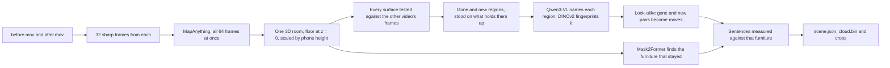

# What changed in the room

Give it two phone videos of the same room, one filmed before you rearranged it and one after. It builds a single 3D model from both, finds the things that moved, appeared or disappeared, and describes each one in a plain sentence. The viewer shows the shared model with every change boxed, the photos each box came from, and the parts of the room that only one video saw.


## See the examples

The ten example rooms are already computed, so looking at them needs only Node 20.9 or newer:

```bash
cd viewer && npm install && npm run dev
```

Then open http://localhost:3000. The room switcher in the corner moves between examples, and `?room=study` opens one directly.

## Run it on your own videos

You need macOS on Apple silicon (the local vision model runs on MLX), [uv](https://docs.astral.sh/uv/) and ffmpeg. The first run downloads about 15 GB of model weights into `~/.cache`.

```bash
scripts/setup.sh                              # builds .venv with the models' dependencies

.venv/bin/room-changes run before.mov after.mov \
  --camera-height 1.4 \
  --out viewer/public/changes/my-room         # two to four minutes on an M-series laptop

cd viewer && npm install && npm run dev       # then open http://localhost:3000/?room=my-room
```

The terminal prints the same sentences the viewer shows. This is the living-room example:

```text
4 things changed between the videos: the armchair moved 2.7 m, the stool moved 2.9 m, the potted plant was removed and a cardboard box appeared.
  c1  moved    The armchair moved 2.7 m from between the bookshelf and the coffee table to the other side of the coffee table and turned about 165° clockwise. (about 85 cm by 85 cm and 95 cm tall)
  c2  moved    The stool moved 2.9 m from near the coffee table to beside the bookshelf. (about 40 cm by 40 cm and 45 cm tall)
  c3  removed  The pink terracotta pot with green leaves beside the bookshelf is gone. (about 55 cm by 50 cm and 1.2 m tall)
  c4  added    A brown cardboard box appeared beside the coffee table. (about 55 cm by 45 cm and 35 cm tall)
```

The basket set on the coffee table is the one change it misses there; it is listed under "Not counted as changes" with the reason (see the known misses).

To reproduce a checked-in example and score it against its answer key:

```bash
.venv/bin/room-changes run examples/living-room/before.mp4 examples/living-room/after.mp4 \
  --camera-height 1.4 --out viewer/public/changes/living-room
.venv/bin/room-changes evaluate viewer/public/changes/living-room examples/living-room/truth.json
```

The reconstruction is deterministic and cached in `~/.cache/sp-changes`, so this rewrites the checked-in files exactly.

| Option | What it does |
|---|---|
| `--camera-height 1.4` | How high you held the phone, in metres. It corrects the reconstruction's scale, which otherwise came out 4 to 40% large on the rendered rooms (the study 40%, the lounge and kitchen 25%) and 17% large on a real shop counter. Leaving it out costs that much accuracy in every distance and size. |
| `--fov 69` | The video's horizontal field of view in degrees, if you know it. Left out, the model estimates it. |
| `--rotate 90` | Turn every frame clockwise by this many degrees, for a video that doesn't record which way is up. Videos from the iPhone camera app do. |
| `--frames 32` | Frames taken from each video, each the sharpest of its stretch. |
| `--namer none` | Skip the vision model. Changes are still found, boxed and placed against the furniture, but each one is called "object". |
| `--fresh` | Reconstruct again instead of reusing the cached result. |

### Filming a pair

Walk slowly around the room at chest height for 15 to 30 seconds, keeping the floor in frame. Film the second video on a different path but over the same area. A spot only one video saw is shown as a blind spot and never reported, so overlap matters more than length. Changes need to be at least about 10 cm across to count (see the tradeoffs).

`scripts/capture_pair.py` cuts two stretches of one phone capture that has an ARKit camera track (a `walkthrough.mp4` with a `poses.json`) into an upright before and after pair, with the camera track as the truth for the scorer.

## How it works



1. **One reconstruction, not two.** All frames from both videos go through [MapAnything](https://github.com/facebookresearch/map-anything) in a single pass. The furniture that did not move ties the two walks together, so there is no separate registration step to get wrong. The room is turned so the floor sits at z = 0 and the walls line up with the axes, and the phone's median height above the floor rescales it to the height you gave.
2. **Seeing through, not differencing.** Each surface point from the before video is projected into every after frame ([`evidence.py`](standardphysics_changes/evidence.py)). If the after camera's depth lands on the point, the surface is still there. If the camera saw farther than the point, its line of sight passed through where the point was, which is evidence that it is gone. If something nearer blocked the view, or no frame pointed that way, the after video says nothing about the point. The same test runs the other way for new things. This third answer is what keeps a different viewpoint, an occluded corner or a spot only one video saw from turning into a change, and the viewer hatches those spots instead.
3. **Regions.** Points that several frames saw through are grouped into connected regions, grown through neighbours the other video never contradicted, and fitted with upright boxes. A region survives only if 85% of all sightlines into it saw empty space. Its box then stands on the floor or the table top underneath, because within about 15 cm of a support depth can't tell an object's base from what it rests on. A raised box with unchanged surface under less than 75% of its footprint hangs in the air, which real things don't, so it is listed as not counted instead of reported.
4. **Names and matches.** Qwen3-VL, running locally, names each region from its two clearest frames, asked one at a time. When the two names are the same kind of thing ("stool" and "wooden stool"), the clearer view's name is used; when they are not ("toy truck" and "stool"), the region is called "an object", sized by its box, because a vague name misleads less than a confident wrong one. DINOv2 turns the region's pixels into an appearance fingerprint. A gone region and a new one that look alike, are of similar size and sit at least 15 cm apart become one move. A leftover piece of the same kind touching either end joins that end, so one chair seen in two pieces stays one chair, and an end whose box lost its legs takes the other end's height. The turn is the yaw that best lays the old shape onto the new one. It is left out when the shape looks the same turned, when the shape and the footprint disagree, and for round things such as stools and drums.
5. **Not counted.** A clump of surface that only one video saw, standing where almost nothing around it was checked either, is listed under "Not counted as changes" instead of being reported, with a sentence saying which video saw it. The hidden back of a sofa is also unseen, but the sofa around it was seen by both, so it is not listed.
6. **Words from geometry.** Mask2Former labels the furniture in the before frames, the labels are voted onto the 3D points, and each unchanged piece gets a box and a name nothing else in the room shares. A piece too long for its kind, such as a desk joined to the bench beside it, is split on a finer grid. When Qwen3-VL names a piece as a different kind of furniture of the right size, such as a nightstand the segmenter called a chair, the piece is re-filed under that kind. A table's height is its densest layer of points, so the base of a basket standing on it can't raise it. "On the coffee table", "between the bookshelf and the coffee table" and "to the other side of the coffee table" are computed from those boxes, so a sentence never places an object somewhere the 3D model does not. A change is never placed against furniture of its own kind, since "the chair moved from beside the chair" tells the reader nothing.

[`pipeline.py:run`](standardphysics_changes/pipeline.py) calls these steps in order.

## Results

### Rendered rooms

Each example is a pair of six-second handheld walkthroughs rendered in Blender from CC0 Poly Haven models by [`render_example_room.py`](scripts/render_example_room.py), using the rooms in [`example_scenes.py`](scripts/example_scenes.py). The footage imitates a phone: the camera shakes and rolls, the shutter blurs motion and reads the sensor top to bottom, the exposure drifts, and the video carries grain and compression. Inputs and answer keys are in [`examples/`](examples), outputs in [`viewer/public/changes/`](viewer/public/changes).

| Room | What it tests | Found | False | Exact names | Right kind |
|---|---|---|---|---|---|
| Living room | Two moves, a removal and two additions, one of them on a table | 4 of 5 | 0 | 4 of 4 | 4 of 4 |
| Studio | A second room, furniture and pair of paths | 4 of 5 | 1, the crate's box | 3 of 4 | 4 of 4 |
| Office | Held out first; the plastic container was never in view of the before video | 3 of 5 | 0 | 1 of 3 | 2 of 3 |
| Bedroom | Held out first; a moved chair and barrel, a trash bag, and a basket set on the nightstand | 4 of 5 | 0 | 1 of 4 | 1 of 4 |
| Kitchen | Held out first; a moved plastic chair and stool, a barrel taken away | 5 of 5 | 0 | 1 of 5 | 4 of 5 |
| Workshop | Held out first; a moved tool cart and school chair, two suitcases set on the desk | 5 of 6 | 0 | 4 of 5 | 5 of 5 |
| Lounge | Held out first; a moved lounge chair and stool, a boombox taken off the coffee table | 4 of 6 | 0 | 1 of 4 | 2 of 4 |
| Study | Held out first; a moved chair and stool, a pot and a jug taken away, two trash cans and a vase set down | 3 of 7, 1 partly | 0 | 2 of 3 | 3 of 3 |
| No changes | The living room twice from different paths | Nothing reported | 0 | | |
| Blind spot | The before walk never looks at half the room, and a crate appears there | The armchair's move; the crate listed as seen by one video only | 0 | 1 of 1 | 1 of 1 |

Across the nine rooms with changes it finds 33 of 44 and 1 more partly, with 1 false alarm. `truth.json` records every object's box in both videos and every camera pose, and `room-changes evaluate` scores a result against it. It lines the estimated camera path up with the true one and matches each true change to a reported one of the same type within 50 cm whose box covers at least a quarter of the object; a report nearby that covers less is counted as partial. It also checks that every piece of furniture a sentence can cite stands where a real unchanged object stands, that nothing listed as seen by one video only is an unchanged object or stands where no object ever stood, and that nothing set aside as hanging in the air sits where a real change happened. A name counts as right only when it is on a short list of synonyms that is never widened after seeing a result; the "right kind" column checks only the last word.

Errors are in the reconstruction's own metres after the camera-height correction, averaged over every before and after box:

| Measure | Office | Bedroom | Kitchen | Workshop | Lounge | Study | Living room | Studio |
|---|---|---|---|---|---|---|---|---|
| Box centre error on the floor | 5.3 cm | 8.0 cm | 5.3 cm | 9.6 cm | 11.2 cm | 12.2 cm | 11.9 cm | 9.7 cm |
| Box bottom error | 1.3 cm | 0.8 cm | 1.4 cm | 1.3 cm | 13.9 cm | 1.6 cm | 1.0 cm | 1.5 cm |
| Box height error | 1.9 cm | 1.5 cm | 1.5 cm | 6.9 cm | 18.4 cm | 3.9 cm | 6.3 cm | 2.8 cm |
| 3D overlap with the true box | 0.68 | 0.65 | 0.60 | 0.53 | 0.51 | 0.63 | 0.55 | 0.57 |
| Distance moved, error | 1.2 cm | 5.6 cm | 3.4 cm | 7.4 cm | 25 cm | 3.7 cm | 4.5 cm | 3.3 cm |
| Camera path error | 2.8 cm | 2.0 cm | 1.8 cm | 3.3 cm | 3.3 cm | 2.7 cm | 3.5 cm | 3.0 cm |

Turns are stated only when the shape search finds one clear best yaw that the footprint agrees with. Four of the five stated turns are within 10° of the truth: the armchairs in the living room (10°) and the studio, the bedroom's chair and the lounge chair. The fifth is wrong: the studio ottoman is said to have turned when its stated angle is 125° off, because its near-square footprint gave the agreement check little to go on.

### Held-out first runs

Every rule in the detector was written against rooms it could see, so a room only tests the detector the first time it is scored. Six rooms were held out that way: each was rendered after the detector was frozen, scored once, and its first score saved unedited in [`results/held-out`](results/held-out). Each first run turned up mistakes, the fixes were checked against every room, and the room then became a development example. The detector fingerprints in those files name development versions that are not part of this branch.

| First run | Found | False alarms | Names exactly right | What it led to |
|---|---|---|---|---|
| [Office](results/held-out/office-first-run.json) | 3 of 5, 1 partly, 1 missed | 0 | 1 of 3 | Scoring a change neither video saw as unobservable, not missed |
| [Bedroom](results/held-out/bedroom-first-run.json) | 5 of 5 | 1, a bed post | 1 of 5 | Leftovers of added regions, plural grammar, then the support rule and two-view naming |
| [Kitchen](results/held-out/kitchen-first-run.json) | 5 of 5 | 1, half of the moved chair | 1 of 5 | Joining one object split into two regions |
| [Workshop](results/held-out/workshop-first-run.json) | 3 of 5, 1 partly, 1 missed | 1, the second suitcase | 3 of 3 | Re-filing and splitting furniture; a truth box for each piece of a model |
| [Lounge](results/held-out/lounge-first-run.json) | 4 of 6, 2 missed | 1, the moved chair's base | 2 of 4 | Joining a fragment that lies under a move's footprint |
| [Study](results/held-out/study-first-run.json) | 3 of 7, 1 partly, 3 missed | 0 | 2 of 3 | Choosing the floor by its height, not its offset |

Across the six first runs, 23 of 33 changes were found with a box covering the object and 3 more partly; of the 30 changes reported, 4 were false alarms. The workshop's suitcase model turned out to be a pair of suitcases that its first answer key boxed as one; re-scored against a corrected key, that first run found 5 of 6 with no false alarms ([`workshop-first-run-corrected-truth.json`](results/held-out/workshop-first-run-corrected-truth.json)).

### Real phone footage

The rendered rooms are the only footage with exact answers. Three real pairs were run as a check; their photos show a shop's staff and a library's students, so only scores and sentences are included, in [`results/real-footage`](results/real-footage).

| Pair | What it was used for | Camera path error | Scale error with a 1.4 m phone height | Reported |
|---|---|---|---|---|
| Shop counter, two stretches of one walk | Tuning: it led to the 85% rule | 8.9 cm | 3.6% (17% with no height given) | Nothing |
| Shop floor, two stretches of one walk | Development: no rule was tuned on it | 13.3 cm | 2.6% | Nothing; one box not counted |
| Library, two captures 15 to 25 minutes apart | Held out: run once | 67 cm | 2.7% | 3 additions: 1 real, 2 false alarms |

On the counter, the first version of the detector reported two open-frame bar stools as removed. From some angles the after video sees through the gaps between a stool's rails, so it reads as partly empty; requiring 85% of all sightlines into a region to see empty space removed both. The shop floor pair used to report "a black computer monitor appeared"; the monitor stands in front of a glass case, and the before video's depth most likely went through the glass. The support rule now lists it as not counted: "an object seems to have appeared 1.5 m above the floor with nothing under most of it".

The library pair is the closest thing here to the task itself: two separate phone captures of the same stretch of a university library floor, taken 15 to 25 minutes apart, with whatever students moved in between. Nothing was staged, so each report was checked by eye against its before and after crops ([`library.json`](results/real-footage/library.json)). "An object appeared near the round table" is real: people sat down there with a yellow rolling chair. "A large object appeared" and "a floor stain appeared" are false alarms, and their crops show why: each after photo looks at a wall and carpet corner, not the open floor its before photo shows. The camera path is 67 cm off ARKit's, against 2 to 3 cm on the rendered rooms, so a single reconstruction did not tie two separate walks of a large open floor together, and its misplaced surfaces read as changes. A real pair with staged changes and hand-measured truth is the next example to add.

<details>
<summary>Known misses, room by room</summary>

- In the living room, the wicker basket set on the coffee table is found and named "a light brown bamboo basket", then set aside as hanging in the air: unchanged table top lies under only 54% of its footprint, against the 75% the support rule needs, because the before video sampled that patch of table top sparsely. Loosening the rule for this one case was not tried, since the false alarms it exists to stop (the bedroom's bed post, the shop's monitor) could not be re-checked against a new threshold.
- In the office, the plastic container that appeared in the corner was in view in none of the before video's frames, so nothing could say whether it was new, and the scorer lists it as unobservable rather than missed. The wooden crate beside both walks' paths, which was only partly seen, is missed.
- In the studio the before video only ever saw one end of the wooden crate. Its box covers too little of the crate to match it, so the scorer counts the report as a false alarm and the crate as missed; the vision model calls it "a wooden step", and the sentence ends "only part of it was ever in view, so it may be larger".
- In the bedroom, the detector calls the moved chair and barrel, the planter box taken away and the trash bag set down a chair, an oil drum, a wooden crate and an object. Its first run also reported "a dark wooden bed post appeared", which did not happen; that box has unchanged surface under only 38% of its footprint, where every real raised change has at least 86%, which is where the 75% support rule came from. The wicker basket on the nightstand forms no region and is missed.
- In the kitchen, the furniture list includes "a white chair" beside the stove, where no chair stands; both the segmenter and the vision model took part of the white stove for one. The viewer labels only furniture a sentence cites, so nothing shows or cites it. The pantry cupboard is listed as a "bookshelf", and the sack was named "a gray metal bucket"; both are wrong.
- In the workshop, the jerry can that was taken away is missed: about half the after video's sightlines into its spot saw empty space, short of the 85% a region needs. A tighter depth-agreement test and a colour check were both tried; each still missed the can and added false regions on real footage, so neither was adopted. The metal rack is listed as a "bookshelf".
- In the lounge, both views of the stool say "toy truck", so it moves as "the toy truck". Its new box is too large, and the moved things' boxes sit 13.9 cm off the floor on average, the worst of any room. Of the two crates set down side by side, one is found and called "an object", and the other is missed. The brass vase on the side table is missed.
- In the study, the moved chair's new box grows through the unseen floor into a trash can set down a few centimetres away, so the chair is boxed 1.3 m by 90 cm and one can is missed. The clay pot is missed because the after video never looked at its spot, and the brass vase because it is 8.2 cm across, under the 10 cm minimum thickness that keeps silhouette slivers out. The jug taken off the console is found as "the small object", but its box covers too little of it to count fully.
- Names that abstain only catch a mistake the views disagree about. Where both views agree on the wrong thing, the name stays: the studio's crate is "a wooden step", the bedroom's planter box "a wooden crate" and the kitchen's sack "a gray metal bucket".

[`tests/test_change_examples.py`](tests/test_change_examples.py) re-scores all ten checked-in results on every test run and pins these misses as numbers, so a fix shows up as a failing test to update and a regression as a failing test to fix. It also checks that every result was made by the detector in this branch.

</details>

## Tradeoffs

- **A change needs a second look.** It counts only where the other video saw through the old or new spot, from several frames. That keeps false alarms down, but a change the second video never pointed at goes unreported. `coverage` in `scene.json` and the bars in the viewer say how much of each video the other one checked.
- **Thin and small things are filtered out.** Regions under 10 cm across their footprint or under about 150 surface points are dropped, along with pixels at the frame edge and within 40 cm of the lens. Each of these filters removed a false alarm on the living room, where every one was a sliver along a silhouette or a smear at the frame edge. A broom or a frame leaning on a wall would be missed.
- **The scale needs a hint.** MapAnything predicts metric depth, but its scale came out 4 to 40% large on the rendered rooms and 17% large on a real counter. A phone height is easy to know and fixes most of that; a measured length in the room would fix the rest, and is not an option yet.
- **Two separate walks of a large space can come apart.** All frames go through one reconstruction so no separate registration step can fail, but on the library pair the camera path came out 67 cm off and two false alarms followed. Nothing yet checks that the walks agree before the comparison is trusted.
- **Glass, mirrors and screens can fake a change.** Depth through glass lands behind it, so an object in front of a display case can read as new or gone. The support rule catches it when the object hangs in the air, but not when it stands on the floor.
- **Repeated open-frame furniture is hard.** Stools and chairs made of thin rails read as partly empty from some angles. A pair of chairs swapped for identical ones would not be seen as a change at all.
- **The vision model is local and Apple-only.** Qwen3-VL runs through MLX. On other machines `--namer none` still finds and measures every change and places it against the furniture.

## Outputs

`--out` gets `scene.json` (the summary, every change with its boxes, sentence, evidence and crops, the furniture, coverage, cameras and the scale used), `cloud.bin` (both videos' points with colour, video, blind-spot flag and change id, laid out as `scene.json` describes), `pictures/` (before and after crops of each change), `evaluation.json` when scored, and small H.264 copies of the two videos for the viewer.

## Layout

| Path | What is there |
|---|---|
| [`standardphysics_changes/`](standardphysics_changes) | The detector: reconstruction, evidence test, regions, naming, matching, sentences, export and the scorer |
| [`tests/`](tests) | Unit tests that need only numpy and scipy, and the re-scoring of every example |
| [`viewer/`](viewer) | The Next.js viewer; its `public/changes/` holds each example's outputs |
| [`examples/`](examples) | Each example's before and after video and its `truth.json` answer key |
| [`results/`](results) | The held-out first runs and the real-footage scores |
| [`scripts/`](scripts) | Environment setup, the Blender example renderer and the capture cutter |

## Tests

```bash
.venv/bin/python -m pytest tests          # after scripts/setup.sh; or any Python 3.11 with numpy, scipy and Pillow
cd viewer && npm test
```
